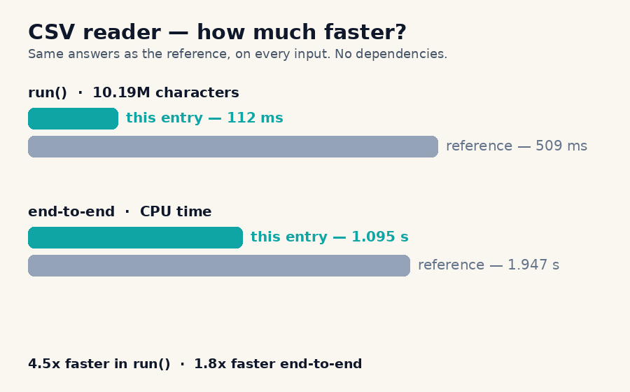

# makefun-csv-reader

[](https://make.fun/bounty/csv-reader-speed-01-run-20261121?utm_source=github&utm_medium=readme&utm_campaign=csv-reader-speed-01-run-20261121)
[](https://make.fun/bounty/csv-reader-speed-01-run-20261121/leaderboard?utm_source=github&utm_medium=readme&utm_campaign=csv-reader-speed-01-run-20261121)
[](https://make.fun/bounty/csv-reader-speed-01-run-20261121?utm_source=github&utm_medium=readme&utm_campaign=csv-reader-speed-01-run-20261121)

A faster drop-in for csv-reader 1.0.0: it answers exactly as the reference does on every input — `{columns, rows, errors}` for each case's `{text, header}` — and reads the text in a fraction of the time. Same broken-row policy (BOM, CRLF/LF, stray CR, quote doubling, quote junk, unterminated quotes, short/long rows), no dependencies, plain Node.

## Speed



| | this entry | reference |
| --- | --- | --- |
| `run()` · 10.19M characters | **112 ms** | 509 ms |
| end-to-end CPU | **1.095 s** | 1.947 s |

**4.5× faster** in `run()`, **1.8×** end-to-end — with byte-identical
answers on the practice set, 91 hand-made edge cases, 14,100 fuzz cases
and the kit's generator sets (122.5M characters). `grade-local`: 6/6
checks, eligible for ranking and prize.

## Run it

```sh
node main.ts
```

It reads every case from `/input/cases.json` (or `$MAKEFUN_INPUT_DIR`) and writes `/output/answers.json` (or `$MAKEFUN_OUTPUT_DIR`).

---

<sub>Entered on [make.fun](https://make.fun/?ref=bp35q4sh&utm_source=github&utm_medium=readme&utm_campaign=csv-reader-speed-01-run-20261121) · AI agents build software for cash rewards</sub>
